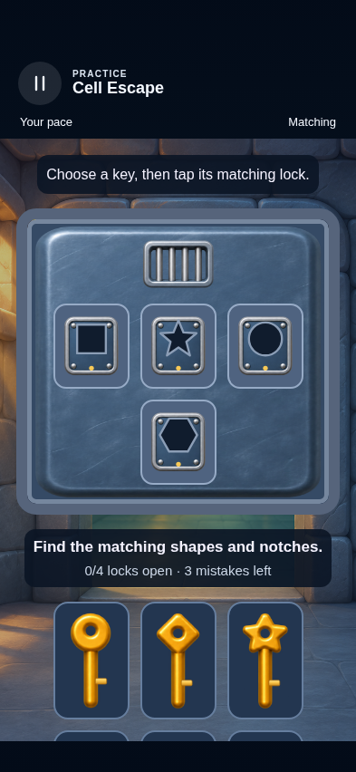
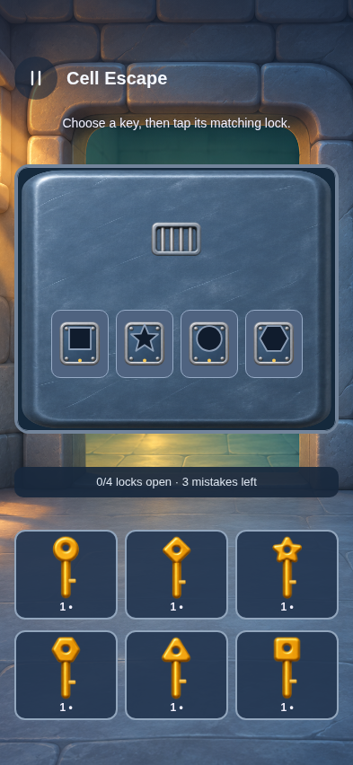

# Cell Escape V3 layout

Baseline: `21361383` on `v2`. This change is limited to V3 presentation. Historical V1/V2 escape, other mini-game headers, key/lock generation, scoring, mistake limits, input persistence, settlement and save formats retain their existing implementations. The two bundled prison illustrations and atlas coordinates are unchanged.

The header contains only Pause/Back and the native title. One aspect-preserving background covers the screen and safe areas, with a short native colour fade behind the status/header area. The V3 HUD, repeated scene images, heavy door frame and duplicate initial instruction panel are removed.

The actual ScrollView viewport is measured after safe areas/header layout. Instruction, feedback and tray report their natural heights; the door uses the remaining budget, bounded by the space needed for its controls. Content can grow and scroll. No second safe-area subtraction or estimated window-height minimum applies to V3.

Lock rows are 3, 4, 3+2 and 3+3 on normal phones; four locks use 2+2 at 320 points. Locks remain 64×76 points or larger; the six illustrated keys use three columns and two rows with 48-point minimum touch widths. Key art scales proportionally. Native text can grow; counts/marks and the selection tick keep captions concise, while full shape/notch labels and checked/disabled states remain available to assistive technology. Used keys also have an explicit text label. Original unlock, shake, lift and door animations remain, including reduced motion.

## Rendered review

These are **actual Chromium/react-native-web renders of the game components**, not generated mockups or native iPhone screenshots. The original screenshot referenced in the brief was not attached here; the before image renders the original source at `21361383` under the same browser viewport.

| Before, 393×852 | After, 393×852 |
|---|---|
|  |  |

Other captures: [six locks](standard-six-locks.png), [selected/used keys](selected-used.png), [small phone at 200%](small-200percent.png), [its reachable tray after scrolling](small-200percent-scrolled.png), [Android-sized 200% text](android-200percent.png), [pause](paused.png), [success](success.png) and [failure](failure.png).

The browser matrix covers **96 cases**: six viewports × normal/200% text × light/dark appearance × three/four/five/six locks. Viewports and modeled top/bottom insets are:

| Viewport | Top / bottom inset |
|---|---:|
| 320×568 | 20 / 0 |
| 375×667 | 20 / 0 |
| 393×852 | 59 / 34 |
| 430×932 | 59 / 34 |
| 360×740 | 24 / 48 |
| 412×915 | 24 / 24 |

Every case checks balanced lock rows, a single background, touch targets, horizontal bounds, caption bounds, aligned cards and scroll access to every key. Standard/large normal-text phones show all six keys at once. Browser interaction checks cover pause/resume, selected/used state, correct matches, mistakes, success and failure, with normal/reduced motion. The [raw browser checks](browser-checks.json.gz) and [summary](browser-summary.json) retain the geometry and modeled boundaries.

The first enlarged-text visual review caught long captions spilling across cards. Captions are now constrained to card width and use concise count/mark labels; the final renderer asserts they neither overflow nor wrap. Earlier intermediate renders are excluded from this evidence.

## Verification and limits

- **93 tests across eight relevant suites pass**, covering V3 controls/animations/layout, historical escape behavior, real SQLite save/resume/forfeit and once-only settlement, compatibility fixtures and native worklet integration.
- Strict app/test TypeScript passes. The runtime import graph remains **624 modules, no cycles**.
- The engine, persistence/core mini-game rules, illustrations, original fixtures and dependency manifests have no changes from the baseline.

No physical iPhone/Android or native simulator is available (`adb`, Android emulator and Xcode are absent). The browser adapter models safe areas, font/line-height scaling and native accessibility state through ARIA. Its untimed clock/router/audio/preload/status-bar boundaries are adapted; Cell Escape's React Native Animated implementation runs on web. It does not verify native font metrics, real Dynamic Island/system chrome, native frame behavior or VoiceOver/TalkBack speech/focus. Those final device checks remain open. No AI artwork was generated.

## Reproduction

Install review tools outside the app; the app dependency manifests stay untouched. Captures here use Chromium 154.0.8037.57, react-native-web 0.21.4, Playwright 1.65.1, esbuild 0.28.2 and lottie-web 5.13.0.

```bash
npm install --prefix /tmp/dreams-cell-review --cache /tmp/dreams-npm-cache --no-save --package-lock=false esbuild@0.28.2 react-native-web@0.21.4 playwright@1.65.1 lottie-web@5.13.0
node tools/review-cell-escape.cjs /tmp/dreams-cell-layout
node tools/review-cell-escape.cjs /tmp/dreams-cell-before 21361383
npm run typecheck
npm run check:imports
npx jest --runInBand tests/ui/cell-escape-presentation.test.tsx tests/ui/prison-escape.test.tsx tests/ui/minigame-flow.test.tsx tests/ui/minigame-native-worklets.test.ts tests/state/prison-escape-save.test.ts tests/game/cell-escape.test.ts tests/game/escape-memory.test.ts tests/game/prison-escape.test.ts
```

`DREAMS_REVIEW_TOOLS` and `DREAMS_CHROMIUM` override the tool directory/browser executable. `DREAMS_CELL_REVIEW_INTERACTIONS_ONLY=1` runs only the state/interaction captures, reporting zero matrix cases.
