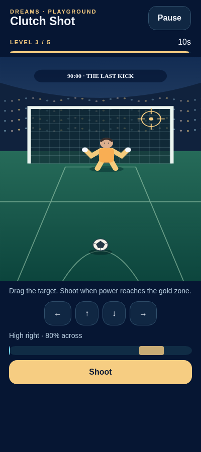
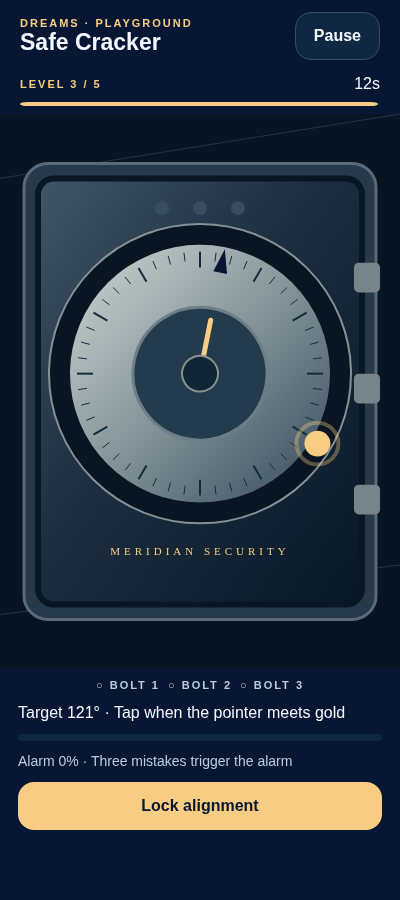
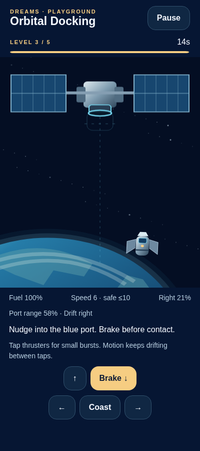

# Mini-game review — 22 October 2026

These images show the actual playground/gameplay components running through React Native Web in Chromium. The harness supplies isolated practice access and disables hardware feedback. They are **browser references**, not Android/iOS screenshots or a native 60 FPS measurement.

| Clutch Shot | Safe Cracker | Orbital Docking |
| --- | --- | --- |
|  |  |  |
| [Result](sports-result.png) | [Result](crime-result.png) | [Result](astronaut-result.png) |

Additional layouts: [320×568 docking](small-phone-docking.png), [768×1024 docking](tablet-docking.png), [Reduced Motion instructions](reduced-motion.png).

The [phone](phone-browser.json), [small-phone](small-phone-browser.json) and [tablet](tablet-browser.json) reports record actual control-driven completion of every game, JavaScript errors and the assisted-control default with Reduced Motion. Difficulty 3 was used. All five levels also have deterministic reachability checks in the game-logic tests.

[Command results](results.json) and the [implementation report](../../MINIGAMES.md) distinguish component/Babel simulation, browser checks, Hermes exports and outstanding physical-device acceptance.

Recreate a browser review with separately installed `esbuild`, `playwright`, `react-native-web` and `lottie-web` tooling:

```sh
DREAMS_REVIEW_TOOLS=/path/to/review-tools DREAMS_CHROMIUM=/path/to/chromium node tools/review-minigames.cjs /tmp/mini-game-review
DREAMS_REVIEW_VIEWPORT=320x568 node tools/review-minigames.cjs /tmp/mini-game-small
```

These optional tools are not added to the app's dependencies and do not touch a saved life.
