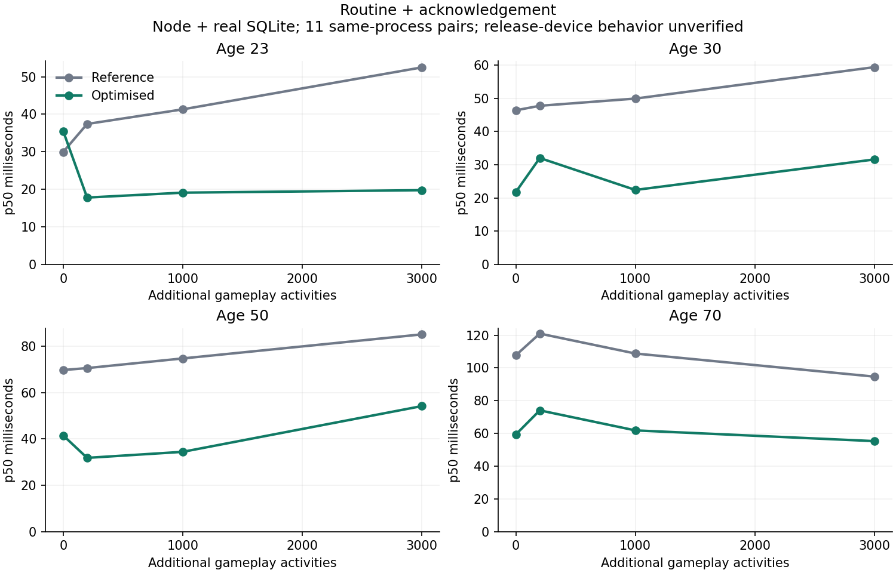
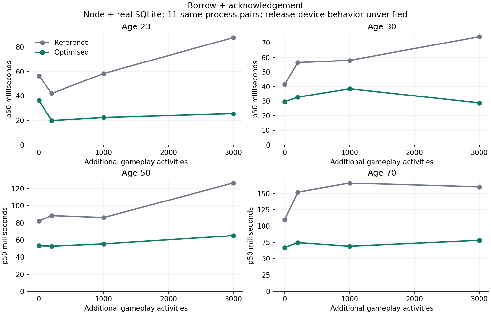
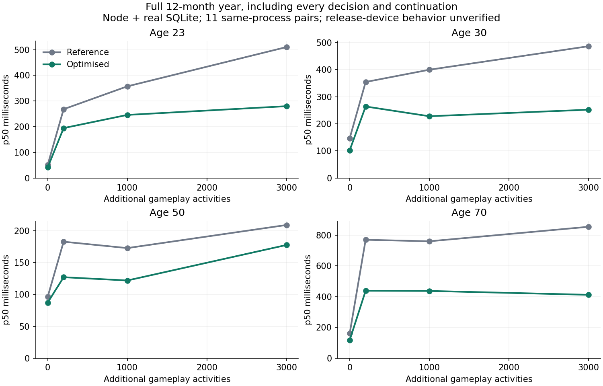

# V2 core scaling verification

This report records the original overhaul. See [the final follow-up](final-followup.md) for the bounded internal profiler, accepted-feature lifetime workloads, reader-copy checks, later measurements and the physical-device collection workflow.

Branch: `v2`. Reference: `8378d0f8` (including changes after audited `05cd38aa`). Final runtime: `4317da3e`. The implementation improves measured history scaling while preserving complete outcomes and saves. **Release-device acceptance remains open; this is not a claim that phone sluggishness is resolved.**

## What shipped

- Private, fully validated ledger certificates and persistent transaction/position indexes. Proven appends update exact BigInt balances and references; edits, removals, reorders and unknown provenance rebuild.
- A central revocable plain-data draft for ordinary commands, with explicit history sharing for monthly advancement. The measured full-proxy monthly prototype was slower, so monthly execution retains its original order and copy implementation. The reference engine remains available for comparisons.
- Conservative incremental subsystem validation from exact immutable dependencies, with complete validation for unknown/imported/recovered state. Journal IDs and per-person date extrema establish all unchanged references and date bounds. No periodic check substitutes for proof.
- Certified append-only journal projection, retaining every historical fact and previous row object. Existing appearance, virtualization, following and manual-scroll behavior remain.
- V5 journal/relationship chunks reuse unchanged compressed history. Readers v1–v4 remain. Reader marker 33 upgrades compatible databases through metadata only; future reader 34 is refused. Saves near an old size boundary fall back to byte-identical v4.
- Command-scoped financial lookups and reuse of the verified index in creative validation. Monthly systems, NPC ordering, RNG draws, purchases, stories, balance, content, art and dependencies are unchanged. Opt-in timing covers all commands, encoding categories, publication, journal projection and scroll attempts.

Implementation/safety checkpoints: [baseline](baseline.md), [ledger](ledger.md), [structural sharing](structural-sharing.md), [checkpoint history](checkpoints.md), [monthly lookups](lookups.md), [size compatibility](boundary.md).

## Complete-store measurements

The primary comparison alternates reference/candidate order in the same Node process, with **11 measured pairs after warm-up** per case. It runs production `gameStore.dispatch`, real on-disk SQLite, review metadata, asynchronous UI yield and journal projection. Cold reopen/backups are checked outside timing. All canonical worlds, RNG, command sequences and review outcomes match; each codec version produces deterministic bytes. These are inclusive **host** durations, with shared-load/GC tails, not native frame or bridge timings.

All 64 age/activity/command combinations are retained in [raw paired samples](store-pairs.json.gz) and [CSV](paired-results.csv). Median latency improves in **59/64** combinations; the five remaining cases are young/light routine or first Age Up. Some p95 results regress, including age-30/50 extreme finance. There is no universal latency or tail improvement claim. All main full-year cases simulate twelve months; the separately retained real Continue This Year case simulates only its remaining months.

The following extreme lives contain **3,000 additional gameplay activities**, excluding acknowledgements:

| Age | Command | Reference p50 / p95 ms | Optimised p50 / p95 ms |
|---|---|---:|---:|
| 23 | Routine + acknowledgement | 52.5 / 75.4 | 19.8 / 66.4 |
| 23 | Borrow + acknowledgement | 87.8 / 100.7 | 25.5 / 47.7 |
| 23 | Complete year | 510.3 / 605.9 | 280.1 / 313.7 |
| 30 | Routine + acknowledgement | 59.4 / 104.4 | 31.6 / 104.7 |
| 30 | Borrow + acknowledgement | 74.3 / 100.9 | 28.8 / 197.2 |
| 30 | Complete year | 486.0 / 707.3 | 252.2 / 379.0 |
| 50 | Routine + acknowledgement | 85.1 / 184.0 | 54.2 / 66.8 |
| 50 | Borrow + acknowledgement | 126.6 / 166.5 | 65.1 / 236.4 |
| 50 | Complete year | 208.8 / 514.9 | 177.5 / 207.7 |
| 70 | Routine + acknowledgement | 94.7 / 129.4 | 55.3 / 61.1 |
| 70 | Borrow + acknowledgement | 160.0 / 201.9 | 78.2 / 95.1 |
| 70 | Complete year | 853.9 / 1024.6 | 411.8 / 707.9 |

The cohorts use real supported commands at ages 23, 30, 50 and 70: ordinary careers/social/family progression plus actual introductions, conversations, paid hobbies, outings, pets and affordable ownership. After bounded feature opportunities, legitimate small loan/repayment cycles grow history without ageing or bypassing cooldowns. This is an explicitly **finance-weighted history stress**, with actual action/revision/record counts in [the baseline](baseline.md); it does not establish uniform use of every feature. Crime is a separate supported-command cohort. No benchmark history, funds, dates, health or RNG were injected. The maximum-size corruption/compatibility control is explicitly synthetic and is not performance evidence.

Separate phase matrices ([before](baseline.json.gz), [final](after.json.gz)) retain p50/p95/max, heap deltas, RSS, GC, monthly subsystem/validator times and serialization/compression/SQLite phases. These separate runs overlap other host work and must not be interpreted as controlled absolute before/after latency. The interleaved complete-store pairs above are the primary comparison. `nativeTransferBytes` is a byte estimate, not milliseconds or measured native bridge time; phase durations overlap. [Synchronous pairs](pairs.json.gz) separately isolate simulation/encoding. [Cold codec samples](cold-codec.json.gz) include mixed cold-load results and final save sizes: current encoding trades roughly one percent extra compressed framing for reusable history. Cold validation remains proportional to total history.

Two real interrupted-year outcomes and eight post-crime outcomes match the reference exactly ([Continue before](continue-before.json.gz)/[after](continue-after.json.gz), [crime before](crime-before.json.gz)/[after](crime-after.json.gz)). The genuine pet scene creates the planning pause through actual choices; no annual cursor is fabricated.

## Correctness and compatibility

- A complete frozen-source invocation passes **424 suites / 7294 tests**, with **zero failures, pending cases or todos**. The [full report](regression.json.gz) and [source manifest](source-manifest.json.gz) are retained. Earlier interrupted invocations are excluded.
- The separate **120-life soak** passes all seeds 0–119, retaining up to **61,470 ledger rows**. Every age-at-death, people count and ledger count matches the retained historical run. These summaries are not complete-world hashes; the separate differential replays provide that stronger check.
- The **6,004-command / 3,000-activity replay** compares complete canonical world and RNG after every command. Before the format change, every packed checkpoint SHA also matches; the final replay round-trips every versioned result. Both retained replays end at the same complete-world SHA.
- All **16** normal inputs retain byte-identical output through the retained v4 writer. The **31,999,936-byte** control additionally proves default-writer fallback, exact old bytes and canonical equality.
- Existing regression covers genuine old saves, exports/imports, independent Time Machine branches, generations/child continuation, rejected commands, save failures, exact retry, receipts, backups and cold SQLite reopening. New cases cover mutation/forgery, duplicate IDs, changed references/dates, raw tail edits, prefix invalidation and corrupted chunks.
- Strict application/test TypeScript, the **621-module acyclic import graph**, and the local notification configuration check pass. Production **Android and iOS Hermes exports** contain all **17** changed runtime sources byte-for-byte in their source maps ([evidence](exports.json)).

[Preservation evidence](preservation.json) confirms original fixtures, art, content, rules, RNG implementation, purchase/access code and dependency manifests are unchanged. Monthly `processMonth`, `finishYear` and `continueYear` bodies match the reference after removing only timing wrappers. The optional notice inventory check finds a **pre-existing stale inventory** with older package/lock hashes; this task changes no dependency or art and does not count that check as passed.

## Allocation and retained memory

[Node/V8 allocation sampling](allocations.json.gz), with a 64 KiB interval and collected objects included, reports **5.26 → 1.69 GB sampled allocation estimates** over 240 routine/acknowledgement commands per side, with identical final worlds. Sampling is not an exact count or a native allocation measurement.

[Real SQLite memory churn](memory.json.gz) alternates 32 loads between two genuine distinct lives, then commits 500 routine/acknowledgement pairs (1,000 commands) without growing journal/ledger history. Retained heap after forced GC is **84.0 MiB after 25 pairs → 85.0 MiB after 500**; process RSS high-water stays **538.0 MiB** across those command samples, including TypeScript/setup. Final cold reopening and backup revision match. This finite observation does not establish unbounded or native memory behavior.

## Remaining acceptance and costs

No physical release iPhone/Android device is connected; this host has no `adb` or `xcrun`. Tap-to-paint, React/GPU commits, actual native bridge/save latency, scrolling, native allocations/GC and sustained mobile memory remain open. Both exports establish build/source compatibility. Device acceptance must follow [the release-device procedure](device-acceptance.md) before calling the user's slowdown resolved.

Flat immutable arrays still require shallow reference copies/freezing, encoded block verification still visits references, and SQLite still reads/writes the complete checkpoint string. Changed-person shape parsing and conservative dependency invalidation can still revisit person/system histories. Active NPC/system complexity remains real work. A new database schema or event sourcing is not introduced without native measurements justifying it.

## Reproduction

Use Node 24, install the pinned dependencies with `npm ci --cache /tmp/dreams-npm-cache`, archive reference `8378d0f8` into an isolated directory and link its `node_modules`. Decompress retained JSON inputs. Drivers assert source stability.

- `tools/prepare-v2-performance-lives.cjs` and `tools/prepare-scaling-lives.cjs`: supported-command inputs and traces.
- `tools/benchmark-scaling-store-pairs.cjs --reference REF --source CURRENT --inputs COHORTS --samples 11 --levels light,moderate,heavy,extreme --output REPORT` (run with `node --expose-gc`): primary comparison.
- `tools/benchmark-scaling.cjs`, `benchmark-scaling-pairs.cjs`, `benchmark-scaling-codec.cjs`: phases, synchronous pairs and cold codecs.
- `tools/compare-scaling-engines.cjs --reference REF --source CURRENT --inputs AGES --commands TRACE --ages 23 --codec versioned --output REPORT`: every-command canonical/RNG/round-trip replay.
- `tools/benchmark-scaling-memory.cjs`, `benchmark-scaling-allocations.cjs`, `verify-scaling-boundary.cjs`: finite churn, sampled allocation and controlled size compatibility.
- `npx jest --maxWorkers=3 --json --outputFile=REPORT`, `DREAMS_SOAK_WORKERS=4 npm run test:soak -- 120`, `npm run typecheck`, `npm run check:imports`.

Set `EXPO_HOME`, `XDG_CACHE_HOME` and npm cache paths to writable temporary directories when exporting in this managed host; do not change the project's dependency files.
