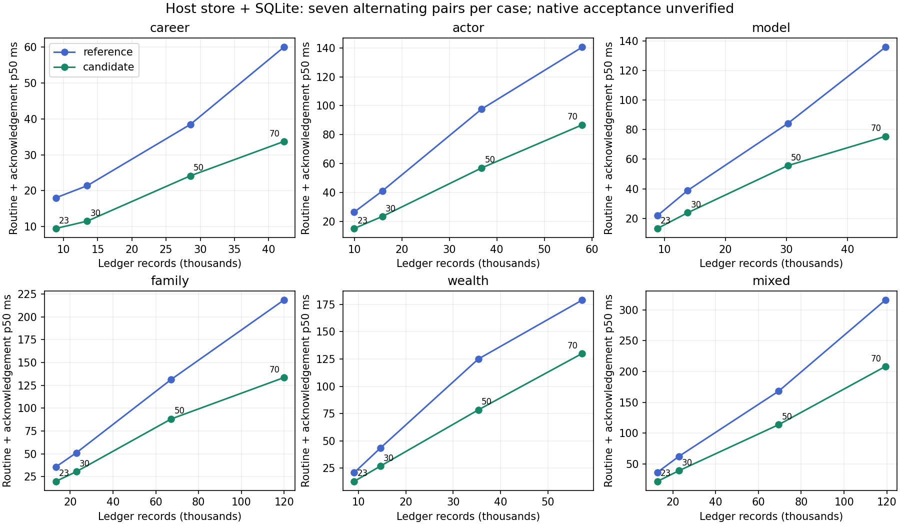

# V2 performance follow-up

Starting point: `26930868`, branch `v2`. The performance reference remains `8378d0f8`. This follow-up adds a bounded internal profiler, broader supported-command inputs, stronger tail measurements and installation-copy verification. It does not redesign the engine, change the database schema/reader marker, alter game logic/RNG/content, or grant purchases.

**Native responsiveness remains unverified. No claim is made that the original two-second iPhone delay is solved.** The signed-device build/collection procedure is [device-profiling.md](device-profiling.md).

## 1. Confirmed improvements and measurement scope

### Final-source controls

The final-source finance controls use **100 alternating pairs** per case, with no other tests/builds/replays active. The original tail regressions do not reproduce; maxima and all raw samples remain retained.

| Case | Reference p50 / p95 / max ms | Candidate p50 / p95 / max ms |
|---|---:|---:|
| Age 30 extreme finance | 43.6 / 65.5 / 187.5 | 21.9 / 40.2 / 103.1 |
| Age 50 extreme finance | 82.6 / 138.3 / 238.8 | 37.3 / 51.1 / 61.5 |

[Final primary samples](followup/tails-final.json.gz), [separate wrapper/phase samples](followup/tails-phases.json.gz), [CPU/GC analysis](followup/finance-analysis.json), [host](followup/host.json) and [reproduction commands](followup/reproduction.md) are retained. The final reference/current source digests are `408c3c1fca27fdb60441c5ab338ba962b67b11f30c59746d3168baa2e32231ac` / `4b244a41cc527335366770039f877e3ebf420a28f50a37de25aa1c598a21eff2`.

| Primary finance age | Reference → candidate median CPU ms | Reference → candidate median heap delta MB | Reference → candidate checkpoint bytes |
|---|---:|---:|---:|
| 30 | 48.4 → 23.6 | 28.6 → 10.0 | 239,481 → 242,870 |
| 50 | 89.3 → 39.4 | 47.2 → 18.1 | 490,613 → 496,617 |

Heap delta is not total allocation volume. In the separate wrapped run, the age-30 candidate maximum is 87.3 ms with 17.3 ms of overlapping GC. The age-50 maximum is 70.1 ms with no GC entry, spread across simulation (20.8), checkpoint (29.1), SQLite wait (7.5) and feedback (11.7 ms). Nested phase spans overlap; do not add them as independent work. These varied outliers do not prove one causal or repeatable new bottleneck. No retrospective cause is assigned to the original 11-pair regressions.

The six-profile matrix contains **120 cases**, with **118 successful comparable cases**, **2 ineligible cases** and **0 matching rejections**. Median latency improves in **115/118**, p95 in **90/118**. Each side has seven measured samples after warm-up, alternating order. At this sample count nearest-rank **p95 equals the maximum**; this is breadth evidence, not a robust tail guarantee. Complete canonical/RNG/command/review outcomes match after every measured continuation. All 24 main complete-year cases simulate twelve months without death or rejection. The two ineligible cases are age-70 actor/model credit requests, which lack qualifying recurring income.

[Raw main samples](followup/gameplay-pairs.json.gz), the [derived summary](followup/results-summary.json) and [all p50/p95/max values](followup/paired-results.csv) retain every measured regression, unavailable action and rejection. Save/reload includes an independent connection/cache read inside timing, with canonical verification outside timing.

| Age-70 profile / operation | Reference p50 / p95 / max ms | Candidate p50 / p95 / max ms | Simulated months |
|---|---:|---:|---:|
| career / routine | 59.9 / 199.7 / 199.7 | 33.7 / 38.8 / 38.8 | 0 |
| career / fullYear | 120.8 / 128.7 / 128.7 | 80.9 / 111.4 / 111.4 | 12 |
| actor / routine | 140.5 / 254.9 / 254.9 | 86.7 / 92.0 / 92.0 | 0 |
| actor / fullYear | 1039.0 / 1420.4 / 1420.4 | 660.4 / 721.7 / 721.7 | 12 |
| model / routine | 135.9 / 231.3 / 231.3 | 75.5 / 148.9 / 148.9 | 0 |
| model / fullYear | 711.0 / 804.8 / 804.8 | 466.4 / 659.6 / 659.6 | 12 |
| family / routine | 218.3 / 374.5 / 374.5 | 133.4 / 318.3 / 318.3 | 0 |
| family / fullYear | 1077.9 / 1265.7 / 1265.7 | 663.6 / 904.8 / 904.8 | 12 |
| wealth / routine | 178.9 / 337.8 / 337.8 | 130.0 / 184.7 / 184.7 | 0 |
| wealth / fullYear | 1039.8 / 1188.5 / 1188.5 | 796.7 / 977.9 / 977.9 | 12 |
| mixed / routine | 316.0 / 466.4 / 466.4 | 208.2 / 225.1 / 225.1 | 0 |
| mixed / fullYear | 2272.4 / 2532.5 / 2532.5 | 1514.7 / 1748.2 / 1748.2 | 12 |

[Genuine Continue controls](followup/continue-pairs.json.gz): all **34/34** medians and **28/34** p95 values improve, with no unavailable/rejected cases. Continue runs simulate the actual remaining months; they are not presented as twelve-month years.

[Initial larger-history controls](followup/history-stress-pairs.json.gz), using the separately retained initial policies with 169,960/180,600 ledger rows at age 70: **5/5** successful comparable medians and **4/5** p95 values improve across six cases. The mixed full-year control is rejected in both implementations and is excluded from those improvement counts; its partial timing remains in the CSV. It is not a completed twelve-month speedup. See the rejection diagnosis below.

### Profiler overhead and allocation sampling

Both sides of the store overhead control use the same final implementation; only the candidate records. Buffer startup and report generation are outside the timing window. Native overhead remains unmeasured. [Store samples](followup/profiler-store.json.gz), [API samples](followup/profiler-micro.json.gz) and [allocation samples](followup/finance-allocations.json.gz) are retained.

| Control | Disabled/reference p50 / p95 / max | Recording/candidate p50 / p95 / max |
|---|---:|---:|
| Actual store routine + acknowledgement, 100 pairs (ms) | 114.3 / 151.5 / 304.3 | 114.2 / 151.4 / 263.3 |
| Synthetic four-event API traces, 101 alternating batches (ns/trace) | 8.9 / 15.2 / 161.9 | 339.0 / 510.9 / 1020.7 |

The actual-store median paired recording/disabled ratio is **1.005** (about 0.5%); the aggregate medians and tails are within host variation. This does not establish zero overhead or a native budget. The API loop is synthetic and can benefit from JIT simplification. It does not predict native or whole-game latency. A lower recording sample is noise, not negative overhead. Allocation sampling is a separate run, excluded from every latency comparison:

| Extreme finance age | Reference estimated sampled GB | Candidate estimated sampled GB |
|---|---:|---:|
| 30 | 2.622 | 0.766 |
| 50 | 4.444 | 1.388 |

These are Node/V8 64 KiB sampled allocation estimates over 200 real borrow/acknowledgement commands per side, including collected objects. Final canonical worlds match. They are not exact byte counts, native allocations or peak memory.

The qualified mixed lifetime also passes **3,992** complete canonical-world/RNG comparisons, one after every command, through age 70. All four saved ages retain exact legacy writer bytes and current-codec round trips. The initial **3,637**-command mixed control remains separately retained. No additional engine optimisation was justified by the reproduced finance tails; the shipped follow-up removes live console observation and supplies native collection rather than guessing at a new storage design.

Age, history and active system complexity vary together in these real policies; this plot does not isolate history-only causality or establish phone responsiveness.

### Initial control against the starting implementation

Two controlled finance cases use **100 alternating pairs per implementation**, with no unrelated test suite/build running. The primary run disables source wrappers and timing listeners; the separate detailed run retains CPU, heap delta, RSS, GC overlap, checkpoint bytes and candidate phases. These initial controls precede the collector implementation. Raw samples are [primary](followup/tails-100.json.gz) and [detailed](followup/tails-100-detail.json.gz).

| Extreme finance case | Reference p50 / p95 / max ms | Candidate p50 / p95 / max ms |
|---|---:|---:|
| Age 30, primary | 43.5 / 78.6 / 148.6 | 21.5 / 46.1 / 86.7 |
| Age 50, primary | 77.4 / 97.2 / 121.4 | 36.6 / 56.1 / 62.9 |
| Age 30, detailed | 44.7 / 64.4 / 133.5 | 21.6 / 42.0 / 97.2 |
| Age 50, detailed | 80.6 / 112.5 / 211.8 | 36.9 / 58.1 / 163.2 |

These initial controls compare `8378d0f8` with `26930868`, before installing the new collector. The earlier candidate p95 points of 197/236 ms are **not reproduced**. Their original cause was not captured, so it is not proven retrospectively. Some new outliers overlap GC; others vary across validation, encoding, SQLite and feedback, including a 163 ms candidate sample without a GC entry. These do not establish one repeatable slow path to fix. Detailed old-reference finance traces lack the expanded phase events; the final separate source-wrapper diagnostic supplies those without treating its times as uninstrumented latency.

### Gameplay breadth

There are **24** complete age-23/30/50/70 inputs across six independent ordinary-birth policies, plus **17 genuine interrupted-year inputs**. [Worlds](followup/gameplay-profiles.json.gz), [complete commands](followup/gameplay-commands.json.gz) and [Continue inputs](followup/gameplay-continue.json.gz) are retained. These replace financial-history padding with actual work, relationships, families, media, ownership, investments, business, leisure, pets and crime.

| Profile at age 70 | Activities excluding acknowledgement/decisions | Journal rows | Ledger rows | Relevant scope |
|---|---:|---:|---:|---|
| Career | 190 | 1,148 | 42,223 | Seven jobs, six actual role changes, work effort, promotions/pay and preventive healthcare |
| Actor | 488 | 2,042 | 57,976 | Training, actual auditions/productions; 47 projects |
| Model | 411 | 1,769 | 46,222 | Training, actual castings, portfolio work; 44 projects |
| Family/social | 2,153 | 4,574 | 119,836 | Relationships, marriage, three children, weekly media and NPC/family histories |
| Wealth | 394 | 1,719 | 57,263 | Investments, a managed business, property/landlord and vehicle activity |
| Mixed | 1,747 | 4,349 | 119,291 | Work/family/wealth combined with hobbies, pets, training and actual crime consequences |

The exact summaries in the raw inputs govern these counts. Global work-history counts include NPCs; project counts above describe the active creative career. Actor/model careers use separate legitimate lives rather than bypassing full-time commitment rules. Special-career generation assumes legitimate entitlement; the core-command generator does not simulate RevenueCat payments. Native paid actions require matching sandbox ownership on both builds.

Initial birth and acknowledgement use the actual store/SQLite transition; subsequent lifetime generation uses the core command API, ordinary ageing and normal eligibility/cooldowns. No money, health, dates, people, outcomes or random streams are injected. Every rejected action remains in the trace metadata. Per-command SQLite persistence is exercised by the measured continuations rather than every birth-to-70 generation command.

These world-only archives contain complete world histories, with no fabricated past Time Machine checkpoints or receipts. They do not reproduce every historical database row of a real installation; existing repository/branch/retry tests cover those separately, and native installation-scale cost remains open.

Career/family/mixed policies include annual check-ups, seasonal vaccination and meditation. Actor/model/wealth retain the original five-yearly check-up policy. The final family/mixed policies use seed 17 and stop manual friend introductions after 16 direct relationships; the other profiles use seed 42. Larger 40-relationship policies are retained as separate explorations. In every case, natural family/NPC growth continues, and no records are removed. The selected seeds/policies are declared, with unsuccessful alternatives retained; this is not a representative population sample. Accepted feature counts are asserted by `tools/assemble-gameplay-scaling.cjs`, including actual marriage, investments, named tenancy management and crime. Rejected quotes/actions are not counted as coverage.

### Profiler and retained memory

The old `console.info` sink is removed. Recording starts only from the internal tools, allocates a preallocated **16,384-slot ring**, writes scalar fields without per-event objects/I/O/logging, and aggregates only on explicit refresh/export. Public builds reject the diagnostics route and recorder start. Both normal and reference profile apps have separate identifiers/containers. The profiler records JS press, simulation, copy/draft, months, validation/indexing, checkpoint, native transaction wait, publication, journal and supported React observations separately; native paint remains explicitly absent.

The new [memory run](followup/memory.json.gz), using the separately retained [initial mixed control](followup/initial-gameplay-profiles.json.gz), switches 32 times between distinct real saves, then commits **1,000 commands** against the mixed age-50 life with **86,487 ledger / 3,272 journal rows**, with recording enabled. The ring retains exactly 16,384 of 52,278 events and reports 35,894 overwrites. After forced GC, heap is **112.9 MiB after 25 pairs → 114.1 MiB after 500**; RSS high-water remains **650.3 MiB** across those command samples. Cold reopening and the previous durable backup match. This is finite Node memory evidence, not native or unbounded-session acceptance.

## 2. Outstanding regressions and unsuccessful policies

Three main cases have higher candidate medians. All are first Age Up steps; their complete-year comparisons are separate cases. These regressions remain open within the host measurement limits.

| Profile / age / operation | Reference p50 / p95 / max ms | Candidate p50 / p95 / max ms |
|---|---:|---:|
| career / 23 / firstAgeUp | 26.7 / 36.2 / 36.2 | 28.4 / 33.1 / 33.1 |
| career / 30 / firstAgeUp | 26.5 / 28.3 / 28.3 | 27.8 / 30.1 / 30.1 |
| family / 23 / firstAgeUp | 43.0 / 156.7 / 156.7 | 51.8 / 62.7 / 62.7 |

There are **28** successful main cases with a higher candidate p95/max in these seven-sample runs. The largest ratios are below; the CSV retains all of them. These new sparse tails do not establish a repeatable native bottleneck or justify weakening validation.

| Profile / age / operation | Reference p95 ms | Candidate p95 ms |
|---|---:|---:|
| mixed / 23 / firstAgeUp | 51.9 | 212.0 |
| career / 70 / firstAgeUp | 63.2 | 161.5 |
| career / 50 / firstAgeUp | 70.9 | 151.2 |
| family / 23 / saveReload | 117.3 | 247.5 |
| mixed / 30 / finance | 76.6 | 154.9 |
| model / 30 / finance | 73.6 | 131.7 |
| model / 70 / firstAgeUp | 117.5 | 199.4 |
| family / 30 / saveReload | 189.4 | 309.1 |
| wealth / 30 / saveReload | 166.8 | 257.3 |
| mixed / 23 / fullYear | 247.5 | 348.6 |
| wealth / 70 / finance | 208.8 | 290.8 |
| model / 23 / fullYear | 287.5 | 374.2 |

The original two 11-pair finance p95 regressions have not reproduced in the 100-pair controls. This does not establish a universal tail guarantee, and all outliers are retained. Broader gameplay and collector-overhead results must be interpreted with their reported sample counts and conditions; no native frame or bridge claim follows from them.

Two unsuccessful exploratory policies are preserved explicitly in [the comparison](followup/explorations.json), with minimal complete checkpoint/command replay inputs beside it:

- An extra preventive-health **model** policy reaches age 64 but the next real Resume command fails with **`Invalid bound event person`** in **both** old and current implementations on identical fully validated input. The successful original model policy is separate. This existing gameplay validation problem is not repaired or concealed by a performance shortcut.
- The initial **unbounded-introduction mixed** policy produces a **90,292,369-byte canonical world** at age 70 that exceeds the supported encoded-world size. Both old and current writers refuse it. This is an engine-generated size-limit exploration, not a claim that the entire trajectory can be durably saved through the UI. The exact first failing durable revision was not measured. The retained bounded mixed profile is a distinct policy; no history is deleted to make it fit.

The reviewed-feature policies also expose the same ceiling: [old/current writer checks](followup/reviewed-size-limits.json) both reject the larger age-70 family and mixed worlds, with **63,558,819** and **63,511,631 canonical bytes** respectively. These use the 40-relationship introduction policy; they are retained alongside the qualified 16-relationship policy, without deleting any history. A reviewed seed-42 family policy ended naturally at age 50 and is also retained. No survivor or size failure is relabelled as successful coverage.

The separately measured **initial mixed age-70** larger-history control also cannot complete its next year. Both stores commit the first three commands through four simulated months, then reject the fourth (`resume`), preserving the same last durable canonical world and receipt count. A [separate diagnosis](followup/initial-history-rejection.json) resolves and packs that exact sequence in both implementations: the failing operation is checkpoint packing, with **`This checkpoint exceeds the supported world size`**. Its partial 1,219.3 → 918.2 ms medians are retained as a **rejection**, excluded from completed-year/speedup totals. The qualified mixed policy is a different declared lifetime; all 24 qualified main complete-year cases finish twelve months.

The existing save-size ceiling therefore remains a real scalability limit. No claim covers arbitrarily large histories or every combination of gameplay systems. Flat array copying/freezing, changed-person schema/history validation, conservative dependency invalidation, encoding and complete checkpoint transfer still require work. No new storage architecture is introduced without native measurements.

## 3. Native measurements actually performed

**None.** There is no physical iPhone/Android, native Instruments/Perfetto trace, installed app measurement, signed EAS artifact or signing-account execution from this host. JS frame callbacks and React commits are scheduling/commit observations, not proof of visible feedback/paint. JSON native fields remain null. The exports and resolved build configurations verify source/configuration compatibility only.

[The device workflow](device-profiling.md) provides Release EAS profiles, a diagnostics-only reference overlay, separate app containers, identical V4 archives, no-debugger JSON sharing/folder export, native trace instructions and a 20-warmed-sample procedure. The overlay asserts **312** original reference engine/content/validation/codec/repository/projection files are byte-identical. A real installed-container upgrade remains unverified.

## 4. Save compatibility and correctness

The retained [reader-32 installation](../../../tests/fixtures/v2-reader32-installation.db.gz) was written by the actual `8378d0f8` repository from genuine archived/command-generated lives. Its [provenance](../../../tests/fixtures/v2-reader32-installation.db.gz.json) identifies all eight populated tables, three lives, receipts, backups, historical snapshots and a restored branch. It is a reproducible installation, not a captured user's App Store database.

The new on-disk test preserves a byte-identical pre-upgrade copy, rolls back an interrupted marker change, cold-retries to reader 33 and checks every original row/payload unchanged before gameplay. It then checks a new V5 save, interrupted receipt insertion, durable rollback, exact retry without duplicated receipts/balances, backup reopening, historical independent branching, complete export/import and future reader-34 refusal. Existing V1–V5/corruption/legacy/archive tests remain required.

The previous-size control passes again at **31,999,936 expanded frame bytes**: the default writer falls back to **byte-identical V4** and the full canonical world round-trips. This is an explicitly synthetic compatibility control, not a natural-life benchmark or a claim about physical checkpoint file size.

**The compatibility boundary is forward-only.** Preserve separate before/after database copies. Old reader-32 apps cannot open an upgraded reader-33 database, and old apps cannot read a new V5 export. Never test downgrade on the only copy. Profile Reference and Profile use different containers for this reason.

The [separate-copy forward-boundary probe](followup/forward-boundary.json) actually runs the old reader against its preserved reader-32 copy, then refuses a separate upgraded reader-33 copy without writes or byte changes. The current reader similarly refuses a distinct future-34 control byte-for-byte. The pre-upgrade file remains exact throughout.

## 5. Remaining acceptance and next steps

1. Install the two internal Release apps and run the documented physical iPhone/Android collection with at least 20 warmed measurements per scenario, including actual first paint, sustained memory, scrolling, app reopen and native transaction/transfer traces.
2. Use those traces to choose the largest repeatable remaining cost. Further engine/storage changes require measured need; the controlled finance results do not justify another redesign.
3. Track the existing model age-64 invalid bound-person event and the extreme size ceiling separately, using the retained reproduction data. Do not weaken validation, drop history or invent successful outcomes to pass either case.
4. Keep the physical acceptance gate open until the evidence supports the original phone-delay claim. Host speedups, successful exports and stable finite Node heap do not close it.

The final complete invocation passes **428 suites / 7,304 tests**, with **zero failures, pending cases, todos or source drift** ([raw result](followup/regression.json.gz), [source manifest](followup/source-manifest.json.gz)). The separate **120-life soak** passes all seeds 0–119, up to **61,470 ledger rows**, and every historical death-age/people/ledger summary matches ([raw soak](followup/soak.json.gz)). Strict application/test TypeScript, the 624-module acyclic import graph, notification configuration checks and both production/internal Android+iOS Hermes exports pass. All **122** checked runtime sources match each export's source map exactly.

Earlier interrupted/resource-killed invocations are excluded from passing totals. An initial concurrent run exhausted this host's 16 GiB memory limit and killed a Jest worker. The final invocation uses `--maxWorkers=3 --workerIdleMemoryLimit=768MB`; the infrastructure incident is retained explicitly and is not counted as an application assertion failure.
